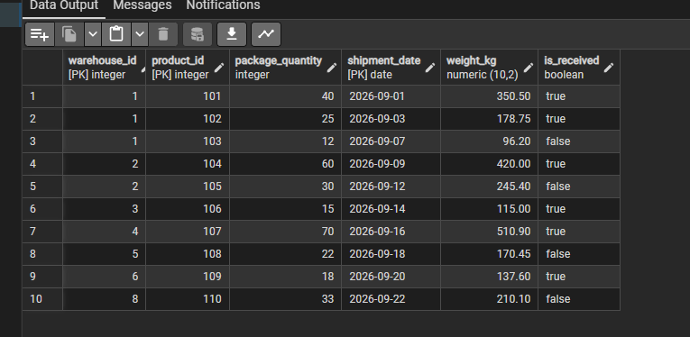
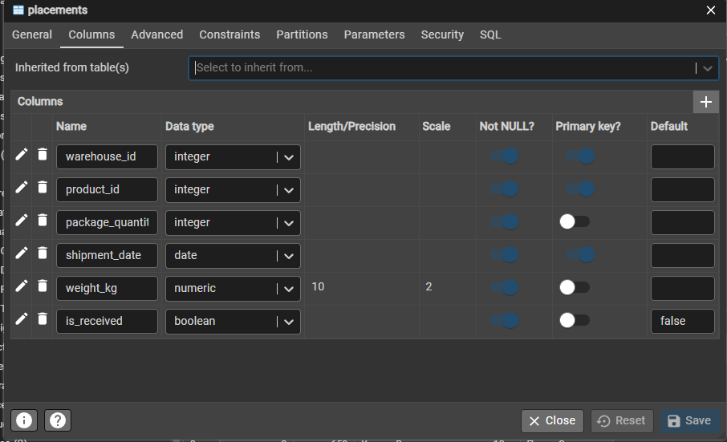
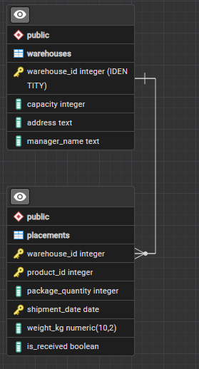

# Лабораторная работа №1

**Тема:** Создание таблиц в PostgreSQL  
**Вариант:** 6  
**СУБД:** PostgreSQL 17  
**Среда:** pgAdmin 4

## Создание базы данных

Создана база данных `warehouse_lab_v6`, содержащая две таблицы: `warehouses` и `placements`.

Для создания таблиц использовались SQL-инструкции `CREATE TABLE`.

**Файл:** [create_tables.sql](create_tables.sql)

### Таблица warehouse

Таблица содержит информацию о складах: номер, вместимость, адрес и заведующий складом.

### Таблица placements

Таблица содержит информацию о размещении товаров на складах: номер склада, код товара, количество упаковок, дату отгрузки, вес и отметку о получении.

## ERD-диаграмма

Между таблицами установлена связь «один ко многим» по полю `warehouse_id`.

## Заполнение таблиц

Для заполнения использовались инструкции `INSERT INTO`.

В каждую таблицу добавлено по 10 записей.

**Файл:** [insert_data.sql](insert_data.sql)

## CSV

Данные сохранены в файлах:

- [warehouses.csv](warehouses.csv)
- [placements.csv](placements.csv)